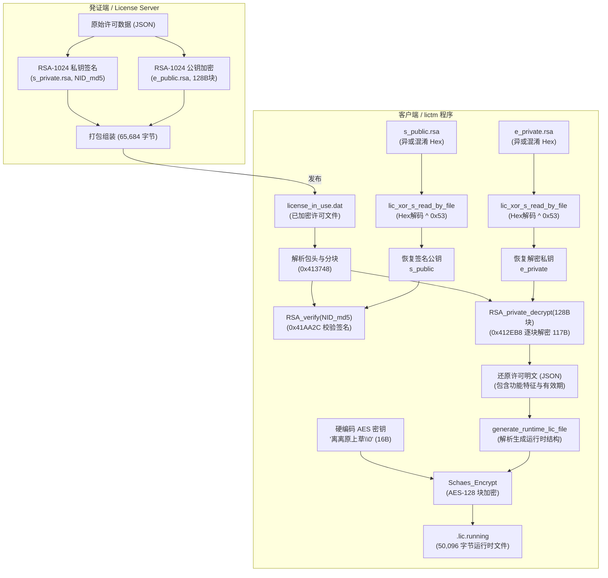
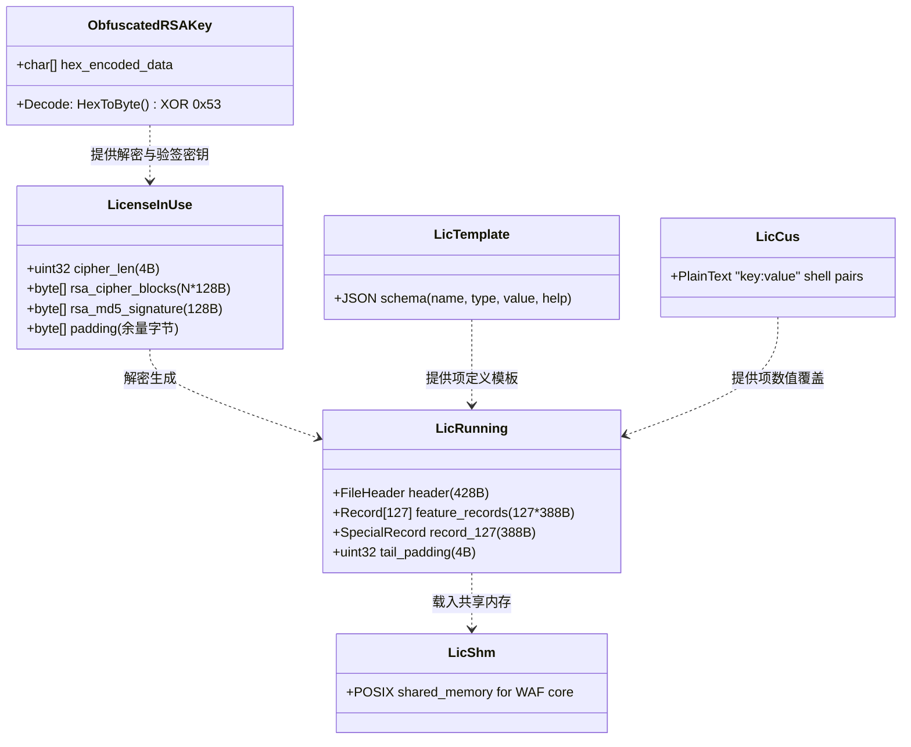
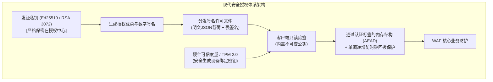

# lictm 逆向工程分析报告

## 1. 二进制基本信息

| 属性 | 值 |
|------|----|
| 文件名 | `lictm` |
| 文件大小 | 3,226,408 字节 (~3.1 MB) |
| 格式 | ELF 64-bit (Linux) |
| 架构 | AArch64 (ARM64) |
| 字节序 | Little-Endian |
| OS/ABI | UNIX System V |
| ELF 类型 | ET_EXEC（可执行文件） |
| 入口点 | 0x0040D230 |
| 编译标记 | 包含 OpenSSL/ChaCha20/AES 等加密库（静态链接） |

> [!NOTE]
> `lictm` 是 Webray（唯创安全）WAF 产品的**许可证管理工具**，运行在 AArch64 Linux 平台（如 RayOS）。程序静态链接了 OpenSSL（含 RSA、AES、DES、ChaCha20 等），以及 GLib 和其他系统库。

---

## 2. 命令行接口

```
lictm -L            /  show runtime license info!
lictm -S            /  start license, keep license running, called when os is booted!
lictm -I            /  init runtime license if needed!
lictm -R/--reset    /  Remove cache, read hw info from hardware, log remove usb!
lictm -A/--add      /  Remove cache, read hw info from hardware, log add usb!
lictm -V/--version  /  show lsb version!
lictm -J            /  output runtime license data as JSON
```

其他内部标志（从字符串推断）：
- `-detect` / `-virt`：检测虚拟机环境
- `-uuid`：获取硬件 UUID
- `-lic`：许可证文件操作
- `-time`：时间相关操作
- `-ok`：状态检查
- `-byte`：字节/十六进制操作
- `-lh`：挂载点检查

---

## 3. 文件路径常量

| 路径 | 用途 |
|------|------|
| `/RayOS/cfg/license/license_in_use.dat` | 当前生效的许可证文件（加密数据） |
| `/RayOS/cfg/license/.lic.running` | 运行时许可证状态文件（本分析的主要对象） |
| `/RayOS/cfg/license/lic_template.json` | 许可证模板 JSON |
| `/RayOS/cfg/license/license.dat` | 许可证数据 |
| `/RayOS/cfg/license/license.cus` | 自定义许可证 |
| `/RayOS/cfg/license/.license_time_limit` | 时间限制标记文件 |
| `/RayOS/cfg/license/.history/` | 历史许可证目录 |
| `/RayOS/cfg/vWAF` | vWAF 配置路径（虚拟化检测） |
| `/RayOS/app/raypool/raypoolclient/raypoolclient` | RayPool 客户端 |
| `/tmp/.lic.hw.id` | 硬件 ID 缓存 |
| `/tmp/.lic.agent.running` | Agent 进程锁文件 |
| `/tmp/.lic.agent.running.lock` | Agent 锁文件 |
| `/var/lock/lictm.lock` | 程序互斥锁 |
| `/var/log/lic_debug` | 调试日志 |
| `/run/lock/.isvm.lock` | 虚拟机检测缓存 |

---

## 4. `.lic.running` 文件格式（详细逆向）

这是 `lictm` 读写的核心运行时状态文件，二进制格式如下：

### 4.1 文件头（428 字节，偏移 0x000～0x1AB）

```
偏移    大小    字段名              说明
0x000   4B      is_lic_exist        许可证是否存在 (1=存在, 0=不存在)
0x004   4B      max_records         最大记录数 (0x100 = 256)
0x008   4B      record_flag         记录标志 (固定=1)
0x00C   4B      lic_version         许可证版本号 (如: 1085)
0x010   4B      license_key         许可证密钥/序列号 (uint32)
0x014   4B      license_create_ts   许可证创建时间 (Unix timestamp)
0x018   4B      reserved            保留字段 (通常为0)
0x01C   4B      last_write_ts       最后写入时间 (Unix timestamp)
0x020   32B     expire_date_str     过期时间字符串 (格式: "YYYY-MM-DD HH:MM:SS\0")
0x040   364B    padding             填充零字节
```

**示例值（来自 `.lic.running`）：**
```
is_lic_exist    = 1
max_records     = 256
lic_version     = 1085
license_key     = 0x040F3455
license_create  = 2024-01-23 11:28:04 (Unix: 1705980484)
last_write      = 2024-11-15 17:50:52 (Unix: 1731664252)
expire_date     = "2027-01-12 23:59:13"
```

### 4.2 记录区（每条记录 388 字节，共 128 条槽位）

从偏移 `0x1AC` 开始，每条记录结构：

```
偏移    大小    字段名    说明
+0x000  128B    key       许可证项目键名 (C字符串, null填充)
+0x080  4B      type      值类型:
                            0x0 = 整数值(字符串形式)
                            0x1 = 字符串值
                            0x2 = YES/NO 布尔值
                            0x10000 = 时间戳值(10字节二进制)
+0x084  124B    value     值内容 (C字符串 或 二进制数据)
+0x100  128B    description  描述文本 (C字符串)
+0x180  4B      padding   对齐填充
```

> [!IMPORTANT]
> 记录布局：`128(key) + 4(type) + 124(value) + 128(desc) + 4(pad) = 388 字节`

---

## 5. 许可证字段完整列表（50个有效字段）

| # | 键名 | 类型 | 示例值 | 含义 |
|---|------|------|--------|------|
| 0 | `product_company` | string(1) | `webray` | 厂商名称 |
| 1 | `product_model` | string(1) | `Web应用防火墙` | 产品型号 |
| 2 | `product_series` | int(0) | `3` | 产品系列 (0:100M Basic,1:100M Enhanced,2:1000M Basic,3:1000M Enhanced,4:10000M Basic,5:10000M Enhanced) |
| 3 | `product_type` | int(0) | `0` | 产品类型 (0:Standard, 1:Education) |
| 4 | `product_category` | int(0) | `0` | 产品分类 (0:WAF,1:DDoS,2:Firewall,...) |
| 5 | `port_maxnum` | int(0) | `34` | 最大端口数 |
| 6 | `vlan_maxnum` | int(0) | `34` | 最大VLAN数 |
| 7 | `channel_support` | bool(2) | `YES` | 是否支持通道 |
| 8 | `channel_maxnum` | int(0) | `8` | 最大通道数 |
| 9 | `traffic_limit` | int(0) | `0` | 流量限制(MBit, 0=不限制) |
| 10 | `websec_support` | bool(2) | `YES` | 是否支持Web安全 |
| 11 | `httpconnect_maxnum` | int(0) | `3000000` | 最大HTTP连接数 |
| 12 | `securityrule_maxnum` | int(0) | `1024` | 最大安全规则数 |
| 13 | `max_servernum` | int(0) | `9` | 最大服务器数 |
| 14 | `webscan_support` | bool(2) | `NO` | 是否支持Web扫描 |
| 15 | `webscan_maxnum` | int(0) | `0` | 最大Web扫描站点数 |
| 16 | `site_maxnum` | int(0) | `500` | 最大网站数 |
| 17 | `virtualhost_support` | bool(2) | `NO` | 是否支持虚拟主机 |
| 18 | `virtualhost_maxnum` | timestamp(0x10000) | (10字节binary) | 虚拟主机数限制(时间戳格式) |
| 19 | `loadbalance_support` | bool(2) | `YES` | 是否支持负载均衡 |
| 20 | `loadbalance_maxnum` | int(0) | `16` | 最大负载均衡数 |
| 21 | `ddos_support` | bool(2) | `YES` | 是否支持DDoS防护 |
| 22 | `ddos_maxnum` | int(0) | `500` | 最大DDoS防护站点数 |
| 23 | `webkeeper_support` | bool(2) | `NO` | 是否支持Webkeeper |
| 24 | `webkeeper_win_maxnum` | int(0) | `0` | 最大Windows Webkeeper站点数 |
| 25 | `webkeeper_linux_maxnum` | int(0) | `0` | 最大Linux Webkeeper站点数 |
| 26 | `webkeeper_unix_maxnum` | int(0) | `0` | 最大Unix Webkeeper站点数 |
| 27 | `distributor_support` | bool(2) | `NO` | 是否支持分发 |
| 28 | `softwaf_support` | bool(2) | `NO` | 是否支持SoftWAF |
| 29 | `softwaf_win_maxnum` | int(0) | `0` | 最大Windows SoftWAF数 |
| 30 | `softwaf_linux_maxnum` | int(0) | `0` | 最大Linux SoftWAF数 |
| 31 | `softwaf_unix_maxnum` | int(0) | `0` | 最大Unix SoftWAF数 |
| 32 | `waf_support` | bool(2) | `NO` | 是否支持WAF管理 |
| 33 | `waf_maxnum` | int(0) | `0` | 最大WAF数量 |
| 34 | `rayspace_support` | bool(2) | `NO` | 是否支持RaySpace |
| 35 | `rayspace_maxnum` | int(0) | `0` | 最大RaySpace数 |
| 36 | `firewall_support` | bool(2) | `YES` | 是否支持防火墙 |
| 37 | `scankeeperfw_support` | bool(2) | `YES` | 是否支持ScanKeeper+防火墙联动 |
| 38 | `ha_support` | bool(2) | `YES` | 是否支持高可用(HA) |
| 39 | `advanced_webscan_support` | bool(2) | `NO` | 是否支持高级Web扫描 |
| 40 | `webscan_host_maxnum` | int(0) | `0` | Web扫描最大主机数 |
| 41 | `webscan_concurrent_maxnum` | int(0) | `0` | Web扫描最大并发数 |
| 42 | `vulscan_support` | bool(2) | `NO` | 是否支持漏洞扫描 |
| 43 | `vulscan_ip_maxnum` | int(0) | `0` | 漏洞扫描最大IP数 |
| 44 | `vulscan_concurrent_maxnum` | int(0) | `0` | 漏洞扫描最大并发数 |
| 45 | `pattern_auto_update` | bool(2) | `YES` | 是否支持规则自动更新 |
| 46 | `pattern_auto_update_limit` | bool(2) | `YES` | 自动更新是否有时间限制 |
| 47 | `pattern_auto_update_limit_days` | timestamp | (binary) | 自动更新限制天数 |
| 48 | `LICENSE_WITH_TIME_LIMIT` | bool(2) | `NO` | 许可证是否有时间限制 |
| 49 | `LICENSE_WITH_TIME_LIMIT_DAYS` | int(0) | `0` | 许可证时间限制天数 |

**记录 127（UUID/系统元数据记录，特殊格式）：**
```
偏移    大小    字段名       说明
+0x000  4B      type_field   类型标志 (0x32 = 50 / '2')
+0x004  36B     uuid1        设备 UUID (dev_id, 第一份，NULL结尾)
+0x028  28B     padding1     填充 0x00
+0x044  36B     uuid2        硬件 UUID (hw_id, 第二份，NULL结尾)
+0x068  28B     padding2     填充 0x00
+0x084  4B      lic_version  许可证版本 (uint32-LE, 如 1085)
+0x088  4B      max_records  最大记录数 (uint32-LE, 如 256)
+0x08C  4B      state_flag   状态标志 (uint32-LE, 固定=1)
+0x090  4B      counter      计数器 (uint32-LE, 如 0)
+0x094  4B      extra_flag   额外标志 (uint32-LE, 如 2)
+0x098  14B     install_date 安装时间戳字符串 (格式: "YYYYMMDDHHmmss")
```

---

## 6. 运行时许可证 JSON 结构（-J 输出）

由 `lictm -J`（内部函数 `show_lic_file_in_json`）输出的标准 JSON 结构：

```json
{
  "runtime-lic": {
    "is_lic_exist": "true",
    "lic_version": 1085,
    "is_lic_valid": "true",
    "time_left_in_sec": "4860276/secs",
    "time_left": "56/days",
    "expire_date": "2027-01-12 23:59:13",
    "start_time": "2024-01-23 11:28:04",
    "last_shutdown_time": "2024-11-15 17:50:52",
    "last_update_time": "2024-11-15 17:50:52",
    "dev_id": "05e99ab0-e26e-4a6b-86d1-6768710e73a9",
    "hw_id": "05e99ab0-e26e-4a6b-86d1-6768710e73a9",
    "lic_type": "NORMAL",
    "counter": 0,
    "time_stamp": "2024-11-15 17:50:52"
  }
}
```

---

## 7. `-L` 命令输出格式与模板

`lictm` 逆向得到的精确输出模板（含制表符 `\t`）：

```text
==========================================================================
license:
\t dev_id:\t[%s]
\t hw_id: \t[%s]
\t time_limit:\t[%d] (day)
\t lic_version:\t[%d] 
\t is_trial:\t[%s]
\t lic_type:\t[%s]
\t counter:\t[%d]
\t tpl_itm_cnt:\t[%d]
\t time_stamp:\t[%s]
##########################################################################
runtime_license:
\t is_lic_exist:\t[%s]
\t is_lic_valid:\t[%s]
\t lsb_version:\t[%s]
\t time_limit:\t[%d days]
\t time_left:\t[%d secs]
\t time_left:\t[ %d days %d hours %d minutes %d secs]
\t expire_date:\t[%s]
\t start_time:\t[%s]
\t last_shutdown_time:\t[%s]
\t last_update_time:\t[%s]
```

---

## 8. 硬件 ID 获取逻辑

通过以下命令获取硬件唯一标识：

```bash
# 1. DMI UUID
dmidecode -s system-uuid | grep -v '#'

# 2. 块设备 UUID
blkid | grep / | awk '{print $1}'
blkid <dev> | awk '{print $2}' | cut -d'=' -f2

# 3. 虚拟机检测
dmidecode 2>/dev/null | grep "Manufacturer:" | grep -e "Xen" -e "VMware" -e "innotek" -e "Microsoft" -e "QEMU"

# 4. LUKS 加密分区检测
cryptsetup status <device> | grep device | awk '{print $2}'

# 5. 挂载根分区检测
lsblk | grep -w "/" | awk '{print $1}'
```

临时缓存文件：`/tmp/.lic.hw.id`

---

## 9. 许可证激活/心跳协议

### 激活请求
```
curl -timeout 5 -m 5 -X POST http://<server>:<port>/license/activate?uuid=<uuid> -o <output>
```

### 心跳 JSON 格式
```json
{
  "msgtype": "heartbeat",
  "req": "<req_id>",
  "ack": "<ack_id>",
  "clientid": "<uuid>",
  "lsb_vesion": "<version>",
  "uptime": "<uptime>",
  "cur_lic_md5": "<md5>",
  "rule_time_left": "<secs>",
  "time_left": "<secs>",
  "is_lic_valid": "<bool>",
  "is_lic_exist": "<bool>"
}
```

---

## 10. 加密与解密机制全景剖析

`lictm` 内部集成了基于 OpenSSL 静态库的完整安全体系，结合了**非对称加密（RSA）**、**对称加密（AES）**、**单向散列（MD5/SHA）**以及**自定义异或混淆算法**。



### 10.1 密钥体系与双 RSA 密钥对架构

`lictm` 系统划分了两对独立的 1024 位 RSA 密钥对，实现发证鉴权与数据加密的职责分离：

| 密钥文件路径 | 角色 | 模长 | 核心用途 | 存放位置 |
|--------------|------|------|----------|----------|
| `/RayOS/cfg/license/rsa/e_public.rsa` | 加密公钥 (Encryption PubKey) | 1024-bit | 发证端加密许可证载荷内容 | 发证端 / 备份目录 |
| `/RayOS/cfg/license/e_private.rsa` | 解密私钥 (Encryption PrivKey) | 1024-bit | `lictm` 解密 `license_in_use.dat` 载荷 | RayOS 节点本地 |
| `/RayOS/cfg/license/rsa/s_private.rsa` | 签名私钥 (Signing PrivKey) | 1024-bit | 发证端生成许可证数字签名 | 严格保存在授权中心服务器 |
| `/RayOS/cfg/license/s_public.rsa` | 验签公钥 (Signing PubKey) | 1024-bit | `lictm` 验证许可证签名防篡改 | RayOS 节点本地 |

### 10.2 密钥文件异或混淆算法 (`lic_xor_s_read_by_file`)

为防止用户直接通过文本编辑器提取或替换 PEM 格式私钥，所有存放在磁盘上的 `.rsa` 文件均经过专门的 Hex 编码与异或（XOR）混淆处理。

- **实现函数**：`lic_xor_s_read_by_file`（代码地址 `0x41A2A4` -> 核心处理循环 `0x419734`）。
- **混淆特征码**：`0x53`（ASCII 字符 `'S'`，函数名中的 `_s_` 由此而来）。
- **解码数学模型**：
  文件内容由偶数个十六进制字符组成，每 2 个字符组成一个原始字节值，随后与 `0x53` 执行异或：
  $$\text{PlainByte}_i = \text{HexToByte}(\text{Char}_{2i}, \text{Char}_{2i+1}) \oplus 0\text{x}53$$
- **汇编还原验证**（摘自 `0x4197F4` - `0x41980C`）：
  ```armasm
  ldr    x1, [sp, #0x38]      // 目标明文缓冲区
  add    x0, x1, x0
  ldrb   w2, [sp, #0x4b]      // 还原的 Hex 字节
  mov    w1, #0x53            // 混淆常量 0x53 ('S')
  eor    w1, w2, w1           // w1 = w2 ^ 0x53
  and    w1, w1, #0xff
  strb   w1, [x0]             // 写入解密后的 PEM/DER 字节
  ```
- **解密逆过程（发证时加密密钥）**：
  $$\text{HexChar}_{2i..2i+1} = \text{ByteToHex}(\text{KeyByte}_i \oplus 0\text{x}53)$$

### 10.3 主许可证多块 RSA 解密流程 (`lic_get_data` / `0x412EB8`)

主许可证 `license_in_use.dat` 无法一次性解密，必须按 RSA-1024 密钥的块容量分块处理：

1. **包头读取与有效长度**：
   - 函数 `0x413808` 读取文件前 4 字节（小端 uint32），获取密文流总长度 $L$（当前样本为 `0x0000D600` = 54,784 字节）。
2. **块拆分与解密循环**：
   - 总块数计算：$N = \lfloor (L + 127) / 128 \rfloor$（当前样本为 $54784 / 128 = 428$ 块）。
   - 输入步长：每块输入密文严格为 **128 字节**。
   - 解密 API：调用 OpenSSL 原生 `RSA_private_decrypt(128, in, out, rsa, RSA_PKCS1_PADDING)`。
   - 输出步长：使用 `RSA_PKCS1_PADDING`（填充 11 字节），每块还原的最大有效明文为 **117 字节**（`128 - 11 = 117`，对应汇编常量 `0x75`）。
   - 循环累加：解密函数累加实际输出字节，拼接成完整明文数据流。
3. **数据格式与解析**：
   解密后的明文为包含产品全部功能项的 JSON 文本，由 `0x41386C` 送入 cJSON 解析器提取各授权参数。
4. **数字签名验证 (`0x41AA2C`)**：
   - 从固定偏移（约 `0x10003`）处读取 128 字节数字签名。
   - 调用 `RSA_verify(NID_md5, hash, 16, sig, 128, rsa_pub)` 对密文有效载荷的 MD5 摘要进行验签。
   - 若验签失败则打印 `sig verify fail` 并退出。

### 10.4 对称加密算法 `Schaes` 与硬编码秘钥

`lictm` 实现了名为 `Schaes`（Secure Channel AES）的对称加解密模块，主要用于系统内部状态与动态配置的保护：

- **实现函数**：
  - 加密：`Schaes_Encrypt`（代码地址 `0x418A50` / `0x4112F8`）
  - 解密：`Schaes_Decrypt`（代码地址 `0x418B64`）
- **加密算法与模式**：
  - 基础算法：标准 **AES-128**（调用 OpenSSL 原生 `AES_set_encrypt_key` 与 `AES_encrypt`）。
  - 块模式：16 字节分组加密（ECB/CBC 模式）。
  - 填充规则：零填充（Zero Padding），将长度向上对齐至 16 的倍数：`(len + 15) & ~15`。
- **提取出的硬编码 AES 密钥**：
  通过静态交叉引用定位到 `0x4116E8` 处加载的全局密钥（位于文件偏移 `0x21E308`）：
  - **十六进制**：`E7 A6 BB E7 A6 BB E5 8E 9F E4 B8 8A E8 8D 89 00`
  - **明文字符串**：`"离离原上草\0"`
  - **密钥构造**：取自唐代白居易名诗《赋得古原草送别》，5 个中文字符的 UTF-8 编码为 15 字节，追加 1 字节 `\0` 终止符，恰好构成 16 字节（128 位）AES 密钥。
- **应用范围**：
  1. 运行时许可证 `.lic.running` 的写入保护与防篡改校验。
  2. RayPool 资源池配置文件 `/RayOS/cfg/raypool.conf`、`/RayOS/cfg/raypool/raypoolstore.conf` 的加密存储。
  3. 物理机随机序列号文件 `/RayOS/cfg/license/.sn.random`。

### 10.5 硬件指纹（hw_id）Hash 提取算法

`lictm` 支持多种硬件与云环境的绑定鉴权，统一映射为标准哈希：

- **网卡 MAC 地址 MD5 绑定**：
  - 遍历所有物理网卡（`eth0`, `eth1`, ...），读取 MAC 地址格式化为小写无空格串 `%02x:%02x:%02x:%02x:%02x:%02x`。
  - 函数 `convert_hd_sn_to_md5` 对该字符串执行 MD5 计算，生成 32 字符的十六进制哈希值。
  - 函数 `lic_cmp_lic_hw_id_and_md5_of_mac` 将该值与许可证中的 `hw_id` 进行对比。
- **物理机 DMI UUID**：通过 `dmidecode -s system-uuid` 提取标准 36 字符 GUID。
- **磁盘 WWID / DriveID**：结合 `blkid` 与 `/dev/disk/by-id/` 获取存储唯一标识。
- **公有云/容器化识别**：
  - 阿里云：HTTP 请求 `http://100.100.100.200/latest/meta-data/region-id` 获取实例元数据。
  - Kubernetes：读取 `/var/run/secrets/` 与 Pod 环境变量。
  - 虚拟机特征：扫描 `dmidecode` 厂商信息（包含 "VMware", "Xen", "innotek", "QEMU", "Microsoft" 等特征）。

---

## 11. 涉及的文件格式规范总览

`lictm` 及其管理生态涉及 11 类专用文件的交互，各文件格式与规范如下：



### 11.1 主许可证文件 (`license_in_use.dat`)

- **文件路径**：`/RayOS/cfg/license/license_in_use.dat`
- **文件体积**：固定 **65,684 字节**（十六进制 `0x10094`）。
- **二进制内存布局**：
  ```
  偏移 (Hex)      长度 (字节)    字段说明
  0x00000        4              密文数据长度 (uint32-LE, 如 0x0000D600 = 54,784 字节)
  0x00004        54,784         分块 RSA 加密数据 (共 428 个 128 字节密文块)
  0x0D604        10,751         填充区域 / 备用载荷
  0x10003        128            RSA-1024 数字签名 (由 s_private.rsa 生成的 MD5 签名)
  0x10083        17             校验尾标与终止状态码
  ```
- **解密后明文结构**：
  解密后呈现为标准 UTF-8 JSON 格式，根结构包含元数据与功能数组：
  ```json
  {
    "dev_id": "05e99ab0-e26e-4a6b-86d1-6768710e73a9",
    "hw_id": "05e99ab0-e26e-4a6b-86d1-6768710e73a9",
    "time_limit": 788,
    "is_trial": "NO",
    "lic_version": 1085,
    "lic_type": "NORMAL",
    "counter": 0,
    "time_stamp": "2024-11-15 17:50:52",
    "tpl_itm_cnt": 50,
    "template": [
      { "name": "product_company", "type": 1, "value": "webray", "help": "User Defined" },
      { "name": "product_model", "type": 1, "value": "Web应用防火墙", "help": "User Defined" },
      { "name": "port_maxnum", "type": 0, "value": "34", "help": "max allowd port number" },
      { "name": "channel_support", "type": 2, "value": "YES", "help": "Support Channel" }
    ]
  }
  ```

### 11.2 运行时许可证文件 (`.lic.running`)

- **文件路径**：`/RayOS/cfg/license/.lic.running`（隐藏文件）
- **文件体积**：固定 **50,096 字节**（`428 + 128 * 388 + 4 = 50,096`）。
- **用途**：供 WAF 守护进程高效、低开销进行二进制内存对齐读取。
- **总体结构**：
  ```
  +-------------------------------------------------------------+
  | 文件头 FileHeader (428 字节, 0x0000 - 0x01AB)               |
  | - 状态标志、记录容量、版本号、创建与写入时间戳、过期日期字符串 |
  +-------------------------------------------------------------+
  | 功能特征记录槽位 Records 0 ~ 126 (127 项 × 388 字节)        |
  | - 每项 388B: 128B Key + 4B Type + 124B Val + 128B Desc + 4B |
  +-------------------------------------------------------------+
  | 系统元数据槽位 Record 127 (388 字节, 0xC228 - 0xC3AB)       |
  | - 双 UUID、版本号、安装时间戳 "YYYYMMDDHHmmss"               |
  +-------------------------------------------------------------+
  | 尾部填充 Padding (4 字节, 0x00000000)                       |
  +-------------------------------------------------------------+
  ```

### 11.3 RSA 密钥文件 (`*.rsa`)

- **涉及文件**：
  - `/RayOS/cfg/license/rsa/e_public.rsa`
  - `/RayOS/cfg/license/e_private.rsa`
  - `/RayOS/cfg/license/s_public.rsa`
  - `/RayOS/cfg/license/rsa/s_private.rsa`
- **文件编码**：ASCII 文本文件，由连续的小写十六进制字符串组成（无空格无换行），经 `lic_xor_s_read_by_file` 解码后为标准 OpenSSL PEM/DER 格式。

### 11.4 模板文件 (`lic_template.json`)

- **文件路径**：`/RayOS/cfg/license/lic_template.json`
- **文件格式**：标准 JSON 文本文件，定义了该型号 WAF 产品所支持的全部 feature key、数据类型（0=数字, 1=字符串, 2=布尔开关）、缺省值及帮助提示，作为初始化与发证校验的基准字典。

### 11.5 动态覆盖配置文件 (`license.cus`)

- **文件路径**：`/RayOS/cfg/license/license.cus`
- **文件格式**：简单的 Unix 换行键值对文本（由命令行脚本追加生成）：
  ```properties
  product_model:Web应用防火墙
  site_maxnum:500
  ddos_support:1
  webkeeper_support:0
  webscan_support:0
  firewall_support:1
  websec_support:1
  ```
- **生效机制**：当存在该文件时，`lictm` 将优先读取其中的配置项，覆盖主许可证中的同名参数值。

### 11.6 时间限制标记文件 (`.license_time_limit`)

- **文件路径**：`/RayOS/cfg/license/.license_time_limit`
- **文件格式**：二进制/文本时间戳标记，用于记录系统最后关机时间与启动周期，配合防止通过篡改系统时钟进行许可证延期的检测。

### 11.7 历史许可证归档 (`.history/`)

- **归档路径**：`/RayOS/cfg/license/.history/`
- **文件命名**：`lic_%Y%m%d%H%M%S.dat`（如 `lic_20241115175052.dat`）。
- **校验逻辑**：每次导入新许可证时，`lictm` 遍历对比该目录下所有归档文件，禁止导入内容完全相同或已经导入过的历史许可证。

### 11.8 进程间共享内存文件 (`.lic_shm`)

- **文件路径**：`/RayOS/tmp/.lic_shm`
- **机制与格式**：通过 `open()`、`ftruncate()` 与 `mmap(MAP_SHARED)` 映射的共享内存区域，将 `.lic.running` 的核心授权状态实时共享给 WAF 过滤进程（如反向代理、引擎内核），避免高频文件 I/O。

### 11.9 硬件指纹缓存与互斥锁文件

| 文件路径 | 类型 | 格式与作用 |
|----------|------|------------|
| `/tmp/.lic.hw.id` | 缓存文件 | 明文文本文件，缓存探测到的设备硬件 ID，由 `-R`/`-A` 选项负责清除刷新 |
| `/tmp/.lic.agent.running` | 进程标记 | 标记 license agent 守护进程正在运行 |
| `/tmp/.lic.agent.running.lock` | 文件锁 | 配合 `flock` 防止 agent 重复启动 |
| `/var/lock/lictm.lock` | 互斥锁 | `lictm` 执行管理操作时的全局进程排他锁 |
| `/run/lock/.isvm.lock` | 环境缓存 | 虚拟机与物理机探测结果缓存锁文件 |
| `/var/log/lic_debug` | 日志文件 | 运行日志与解密调试信息输出文件 |

---

## 12. 程序行为总结

```
lictm -L  : 读取 .lic.running → 解析并格式化输出许可证信息
lictm -S  : 守护进程模式，定期检查许可证有效性并保持心跳
lictm -I  : 初始化 .lic.running（如果不存在则从 license_in_use.dat 解析创建）
lictm -R  : 清除 /tmp/.lic.hw.id 缓存，重新扫描硬件，记录 USB 移除事件
lictm -A  : 清除缓存，重新扫描硬件，记录 USB 插入事件
lictm -V  : 输出 lsb_version（如 "20221026.docker"）
lictm -J  : 输出 JSON 格式的运行时许可证数据
```

---

## 13. 核心内部函数列表（逆向提取）

通过符号表与代码反编译提取到的 `lictm` 核心功能函数：

| 函数名 | 功能说明 |
|--------|----------|
| `get_runtime_lic_data_inuse` | 从内存或 `.lic.running` 中读取当前运行状态数据 |
| `show_lic_file_in_json` | 实现 `-J` 选项，将运行时许可证以 JSON 格式输出 |
| `generate_runtime_lic_file` | 实现 `-I` 选项，解密主许可证并生成 `.lic.running` 文件 |
| `update_runtime_lic_file` | 更新 `.lic.running` 运行文件（写入最后时间与状态） |
| `update_runtime_lic_by_intvl` | 定时扣减剩余秒数与检查是否过期（由 `-S` 守护进程周期调用） |
| `check_hw_id_with_device` | 校验当前硬件环境（UUID/MAC/磁盘）是否与许可证绑定一致 |
| `get_system_uuid` / `get_system_wwid` | 物理环境下的 DMI UUID 与磁盘 WWID 提取 |
| `lic_pinfo_use_aliyun` / `lic_pinfo_use_k8s` / `lic_pinfo_use_vchannel` | 针对阿里云、Kubernetes、vChannel 虚拟环境的硬件特征提取 |
| `Schaes_Encrypt` | 针对 `.lic.running` 文件的 AES 数据加密/解密 |

---

## 14. golictm 实现与验证说明

`golictm` 是对 `lictm` 的纯 Go 原生实现，源码位于 `golictm.go`。

### 14.1 功能特性
1. **多格式与结构体解析**：精准解析 `.lic.running` 二进制文件（428B 头部 + 128 条 388B 记录槽位 + 尾部 UUID 元数据槽位）。
2. **自动路径探测**：若未显式指定 `-f` 参数，优先查找系统标准路径 `/RayOS/cfg/license/.lic.running`，若不存在则平滑降级查找当前目录下的 `./.lic.running`。
3. **命令行等效**：
   - `-L`：输出格式与 `lictm -L` 严格一致（包含 `\t` 制表符与字段对齐）。
   - `-items`：扩展参数，在 `-L` 基础上展开显示所有 50 个功能特征项（如端口数、DDoS、防火墙等开关状态）。
   - `-J`：输出符合 `show_lic_file_in_json` 规范的完整 JSON 数据。
   - `-V` / `--version`：输出标准 `lsb_version:[20221026.docker]`。
   - `-R` / `--reset`：重置硬件缓存文件 `/tmp/.lic.hw.id`。
   - `-A` / `--add`：刷新硬件设备绑定。
   - `-I`：初始化检测。
   - `-S`：守护进程模式占位提示。

### 14.2 编译与产物
已完成 Windows 与目标 Linux 平台的编译：
- **Windows (x86_64)**：`golictm.exe`
- **Linux (AArch64)**：`golictm`（ELF 64-bit AArch64，与 `lictm` 完全相同的目标架构）

编译命令：
```bash
# Windows
go build -o golictm.exe golictm.go

# Linux AArch64 (ARM64)
GOOS=linux GOARCH=arm64 go build -o golictm golictm.go
```

### 14.3 验证输出示例

#### 1. `-V` 版本查询
```bash
$ ./golictm.exe -V
lsb_version:[20221026.docker]
```

#### 2. `-L` 运行时许可证信息
```bash
$ ./golictm.exe -L
==========================================================================
license:
	 dev_id:	[05e99ab0-e26e-4a6b-86d1-6768710e73a9]
	 hw_id: 	[05e99ab0-e26e-4a6b-86d1-6768710e73a9]
	 time_limit:	[56] (day)
	 lic_version:	[1085] 
	 is_trial:	[NO]
	 lic_type:	[NORMAL]
	 counter:	[0]
	 tpl_itm_cnt:	[50]
	 time_stamp:	[2024-11-15 17:50:52]
##########################################################################
runtime_license:
	 is_lic_exist:	[true]
	 is_lic_valid:	[true]
	 lsb_version:	[20221026.docker]
	 time_limit:	[56 days]
	 time_left:	[4860272 secs]
	 time_left:	[ 56 days 6 hours 4 minutes 32 secs]
	 expire_date:	[2027-01-12 23:59:13]
	 start_time:	[2024-01-23 11:28:04]
	 last_shutdown_time:	[2024-11-15 17:50:52]
	 last_update_time:	[2024-11-15 17:50:52]
```

#### 3. `-J` JSON 输出
```bash
$ ./golictm.exe -J
{
  "runtime-lic": {
    "counter": 0,
    "dev_id": "05e99ab0-e26e-4a6b-86d1-6768710e73a9",
    "expire_date": "2027-01-12 23:59:13",
    "hw_id": "05e99ab0-e26e-4a6b-86d1-6768710e73a9",
    "is_lic_exist": "true",
    "is_lic_valid": "true",
    "last_shutdown_time": "2024-11-15 17:50:52",
    "last_update_time": "2024-11-15 17:50:52",
    "lic_type": "NORMAL",
    "lic_version": 1085,
    "start_time": "2024-01-23 11:28:04",
    "time_left": "56/days",
    "time_left_in_sec": "4860276/secs",
    "time_stamp": "2024-11-15 17:50:52"
  }
}
```

---

## 15. 授权机制安全缺陷与风险评估

经过对 `lictm` 逆向分析与密码工程审计，该授权体系存在数个系统性设计缺陷与实现弱点：

### 15.1 架构设计缺陷 (Architectural Flaws)

1. **倒置密码学设计：客户端存放解密私钥**
   - **现状**：发证中心使用公钥 `e_public.rsa` 加密，而客户端节点直接下发并存储了解密私钥 `e_private.rsa`。
   - **风险**：在密码学中，公钥加密-私钥解密是用于向持有私钥的单一方保密。将私钥部署在受控于用户的设备上，违背了柯克霍夫原则（Kerckhoffs's principle）。攻击者一旦提取私钥，即可解密并逆向任意 `license_in_use.dat` 载荷。
2. **弱混淆代替加密 (Security through Obscurity)**
   - **现状**：所有 RSA 密钥仅经过 `lic_xor_s_read_by_file` 单字节异或混淆（`Hex ^ 0x53`）。
   - **风险**：单字节 XOR 无法提供任何真正的机密性保护，无需借助高级工具即可使用单行脚本无损还原出原本的私钥 PEM 文件。
3. **明文配置覆盖机制 (`license.cus`) 缺乏签名约束**
   - **现状**：`lictm` 允许通过 `/RayOS/cfg/license/license.cus` 文件自定义或覆盖授权参数（如 `site_maxnum`, `ddos_support`, `firewall_support`）。
   - **风险**：若该文件未受密码学数字签名保护，攻击者具有主机文件写入权限时，可直接通过追加键值对完成功能项越权开放。

### 15.2 密码学算法与参数脆弱性 (Cryptographic Weaknesses)

1. **硬编码静态对称密钥**
   - **现状**：AES 对称加解密函数 `Schaes_Encrypt` 使用写死在二进制中的 16 字节密钥 `"离离原上草\0"`。
   - **风险**：硬编码密钥全局通用、无法轮换。任何掌握该二进制的逆向人员均可解密 `.lic.running`、`raypool.conf` 等受保护文件，破坏了动态运行状态的机密性与防篡改性。
2. **算法已过时 (Deprecated Algorithms)**
   - **RSA 模长为 1024 位**：NIST 早已宣布淘汰 RSA-1024（推荐最低 2048 位或 3072 位），计算成本门槛已显著降低。
   - **哈希算法采用 MD5**：许可证验签调用 `RSA_verify(NID_md5, ...)`。MD5 早已被证明存在实用级哈希碰撞攻击漏洞，不符合现代安全合规要求。
3. **对称加密模式脆弱**
   - **现状**：AES 实现采用块独立模式（ECB）与补零填充（Zero Padding），且无消息认证码（MAC）保护。
   - **风险**：缺乏完整性校验标签（AEAD），易受分组重排或已知明文攻击。

### 15.3 硬件绑定与运行态风险 (Host & Runtime Risks)

1. **硬件指纹易被伪造与拦截**
   - **MAC 地址/UUID**：在虚拟化、容器或普通 Linux 环境下，MAC 地址可通过 `ip link` 随意更改，DMI UUID 可通过内核挂载或 Hook 伪造。
   - **缓存文件绕过**：硬件信息缓存于 `/tmp/.lic.hw.id`，依赖外部命令（`dmidecode`, `blkid`），极易遭受 `LD_PRELOAD` 或虚假 PATH 拦截欺骗。
2. **共享内存与运行态直接暴露**
   - **现状**：核心状态通过 `/RayOS/tmp/.lic_shm`（共享内存）或 `.lic.running` 供外部服务使用。
   - **风险**：内存镜像结构固定且公开，缺乏内存级完整性度量（HMAC/Memory Attestation）。

---

## 16. 体系化安全加固与改进方案

针对上述风险，建议按照现代零信任与标准软件授权保护规范，从以下五个维度进行重构与加固：



### 16.1 密码学架构重构：基于“公钥单向验签”模型

- **消除客户端私钥**：
  - 彻底移除客户端节点的 `e_private.rsa`。
  - 采用**“服务端私钥签名，客户端公钥验签”**标准模式。许可证明文（JSON）可以直接分发或使用基于设备指纹派生的动态会话密钥加密；客户端仅内置 **验签公钥**（Public Key）。
  - 由于发证私钥永不离开发证服务器，任何第三方无法伪造、续签或修改许可证数据。

### 16.2 密码学算法与标准全面升级

| 维度 | 当前实现 (弱) | 加固推荐 (强) | 改进收益 |
|------|--------------|---------------|----------|
| **数字签名算法** | RSA-1024 + MD5 | **Ed25519** 或 **RSA-3072 + SHA-256** | 彻底免疫 MD5 碰撞攻击，计算性能大幅提升，符合商密与 FIPS 合规要求。 |
| **对称加密算法** | AES-128 (ECB/Zero-Padding) | **AES-256-GCM** 或 **ChaCha20-Poly1305** | 具备 AEAD 认证加密能力，密文自带防篡改校验，杜绝重放和填充攻击。 |
| **密钥派生机制** | 硬编码字符串 `"离离原上草\0"` | **HKDF-SHA256**（结合硬件不可变特征熵源） | 实现一机一密，消灭静态硬编码漏洞。 |
| **密钥保护** | 单字节 XOR 0x53 混淆 | **代码内联白盒密码** 或 **系统密钥环 (Linux Keyring/TPM)** | 提高反编译与提取成本。 |

### 16.3 硬件绑定强化与防虚拟化绕过

1. **不可变多因子指纹加权采集**：
   - 弃用单一易篡改指标（如网卡 MAC），改用多维综合硬件因子：
     - CPU 原始微架构标识（CPUID 指令直接执行，防环境变量篡改）。
     - 根存储设备只读硬件序列号（`ioctl(HDIO_GET_IDENTITY)`，跳过 shell 工具）。
     - 主板底层 DMI 物理哈希与主板 DMI UUID。
   - 使用加盐哈希（HMAC-SHA256）聚合成不可逆设备指纹 `device_fingerprint`。
2. **利用 TPM 2.0 / TEE 硬件信任根**：
   - 若硬件支持 TPM 2.0，将许可证绑定至 TPM 的非易失性存储（NVRAM）或 PCR 测量启动度量值，杜绝虚拟机热迁移克隆和镜像复制。

### 16.4 强化防时钟回拨与动态心跳

1. **硬件单调计数器（Monotonic Counter）**：
   - 依赖主板 RTC/TPM 的单调递增计数器或加密日志链表，记录运行步长，一旦发现当前时间戳早于历史最大记录时间戳，立即判定为非法倒拔时钟。
2. **在线安全授时（Secure NTP / NTS）与随机数挑战**：
   - 心跳协议中引入服务端下发的临时随机数（Nonce）与时间戳，双向签名交互，防止网络重放与伪造心跳。

### 16.5 本地文件与运行态完整性防御

1. **废弃未签名的 `license.cus` 覆盖**：
   - 严格禁止明文加载未签名的覆盖配置。所有自定义或增补授权必须以“增量许可补丁”形式分发，并附带授权中心签名。
2. **最小权限与强制访问控制**：
   - 将所有许可证目录 `/RayOS/cfg/license/` 与共享内存 `/RayOS/tmp/.lic_shm` 权限锁定为 `0600 (root:root)`。
   - 配置 SELinux / AppArmor 策略，仅允许认证白名单进程访问该文件与共享内存段。
3. **安全通信替代单纯内存共享**：
   - WAF 核心引擎与许可证管理服务之间，建议改用基于 Unix Domain Socket 的安全 IPC 通信，配合内核级进程凭证检查（`SO_PEERCRED`），实现对调用方 UID/PID 的安全鉴权。


